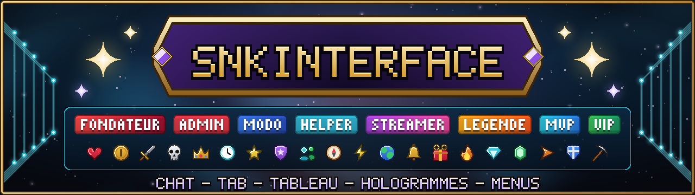
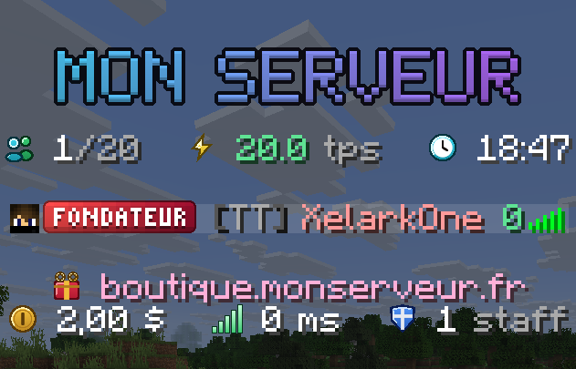
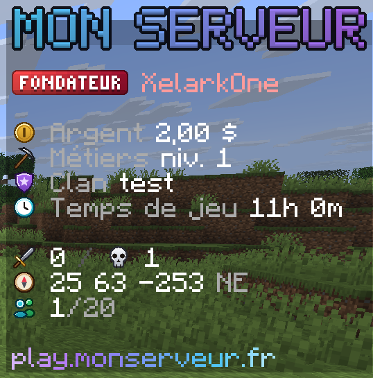
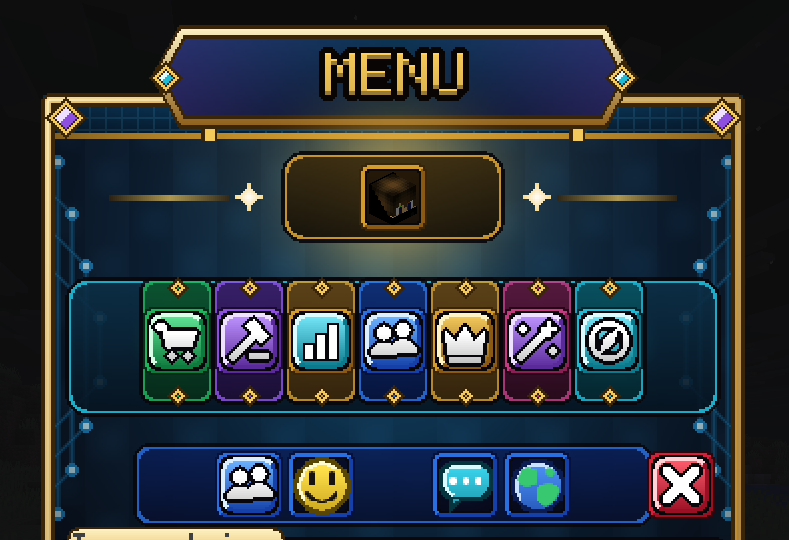
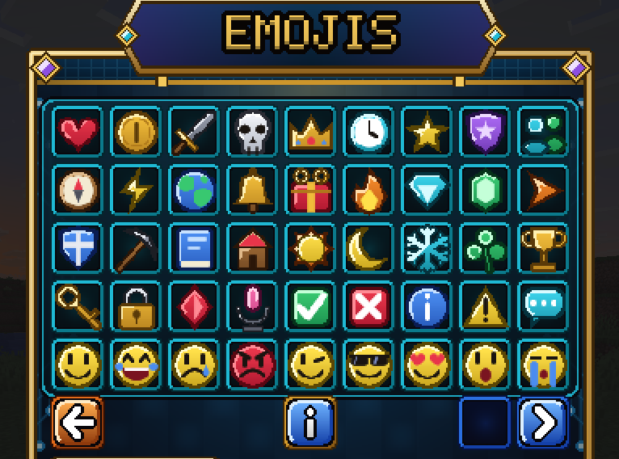
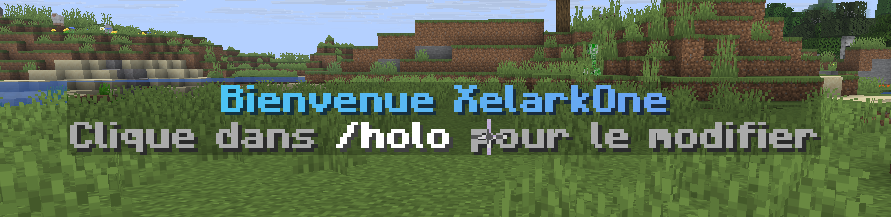
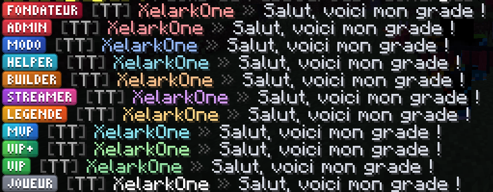

<b>Chat, TAB, tableau, hologrammes, menus et annonces : toute l'interface de ton serveur dans un seul plugin.</b> 
Plugin Minecraft pour serveurs <b>Paper 1.21.4 à 26.3</b>, par <b>SnkAlex</b>. Fonctionne avec <b>LuckPerms</b>.

<a href="#-fonctions">Fonctions</a> •
<a href="#-captures">Captures</a> •
<a href="#-les-grades">Grades</a> •
<a href="#-commandes">Commandes</a> •
<a href="#-compatibilité">Compatibilité</a> •
<a href="#-lobtenir">L'obtenir</a>

---

## ✨ Fonctions

### 💬 Chat
- Un format par grade, des infos **au survol** du pseudo et un clic pour écrire au joueur
- **Canaux** : global, local (par distance), commerce, staff, et les tiens
- `[objet]`, `[inv]`, `[pos]`, **mentions**, liens cliquables et **55 emojis et icônes dessinés**
- **Messages privés**, réponse rapide, joueurs ignorés, espion pour le staff
- **Filtre** : délai, répétitions, majuscules, flood, liens, adresses de serveur, mots interdits (même déguisés)
- **Mute** avec durée, chat coupé, ralenti ou vidé, journal dans des fichiers

### 📋 Liste TAB et pseudos
- Haut et bas animés, **grand titre dessiné**, tri par grade, ping
- Grade et clan **au-dessus des têtes**, vie sous le pseudo
- Avec SnkClans, la couleur du pseudo change selon **celui qui regarde** : allié, ennemi ou en guerre

### 📊 Tableau
- Plusieurs modèles selon le monde, le grade ou n'importe quelle condition
- Lignes qui apparaissent seulement si c'est utile, textes animés
- Deux tailles : **chaque joueur choisit la sienne**, ou le cache

### 🔮 Hologrammes
- Textes, **objets 3D qui tournent**, têtes, pages, actions au clic
- **Chaque joueur voit ses propres infos** dans le même hologramme
- **Classements** automatiques : argent, temps de jeu, kills, monstres, métiers, ou n'importe quelle variable
- Tout se crée et se règle en jeu avec `/holo`

### 🧭 Menus
- Un **menu principal dessiné** qui ne montre que les plugins installés
- **Créateur de menus** : un fichier par menu, avec conditions, prix, permissions, actions et sa propre commande
- Un objet peut ouvrir le menu (il ne peut être ni jeté ni déplacé)

### 📣 Et aussi
- Barres en haut de l'écran, barre d'action, **compte à rebours**
- Annonces automatiques, messages d'arrivée et de départ par grade, message d'accueil
- Texte dans la liste des serveurs, **mode maintenance**
- **Éditeur en jeu** : nom du serveur, tableau, TAB, annonces et accueil, sans toucher aux fichiers
- Chaque partie peut être coupée séparément

---

## 📸 Captures

<table>
<tr>
<td align="center" width="50%"> La liste TAB</td>
<td align="center" width="50%"> Le tableau, en taille normale</td>
</tr>
<tr>
<td align="center"> Le menu principal</td>
<td align="center"> Les emojis</td>
</tr>
</table>

 Un hologramme avec le pseudo de celui qui le regarde

---

## 🏅 Les grades

- SnkInterface **ne crée aucun grade** : il affiche ceux de **LuckPerms**, et l'affichage suit tout de suite quand un grade change
- Chaque grade reçoit une **plaque dessinée** à son nom et à ses couleurs, dégradé compris, sans rien dessiner toi-même
- Un clic dans le menu permet d'**essayer l'apparence d'un grade** pendant 30 secondes
- Sans LuckPerms, il utilise les préfixes fournis par Vault, ou un fichier de groupes

---

## ⌨️ Commandes

| Commande | Effet |
|---|---|
| `/menu` | Le menu principal |
| `/reglages` | Tableau, sons, mentions, canaux, messages privés |
| `/msg`, `/r`, `/ignorer` | Messages privés |
| `/canal`, `/emojis`, `/tableau [petit\|normal]` | Chat et affichage |
| `/sc`, `/chat vider\|couper\|lent`, `/mute`, `/demute`, `/espion`, `/annonce` | Staff |
| `/holo` | Les hologrammes |
| `/interface` | Menu d'administration et éditeur |

**Permissions principales :** `snkinterface.admin`, `snkinterface.holo`, `snkinterface.staff`, `snkinterface.mute`, `snkinterface.annonce`, `snkinterface.chat.couleurs`. La liste complète est dans le guide.

---

## 🧩 Compatibilité

| | |
|---|---|
| **Versions** | 1.21.4 à 26.3, un seul fichier pour toutes |
| **Testé sur** | Paper 1.21.4, 1.21.11, 26.2 et 26.3, avec LuckPerms |
| **Serveur** | Paper |
| **Java** | 21 ou plus (celui de ta version de Paper) |
| **Pack de ressources** | Fourni et conseillé. Sans lui, tout s'affiche en texte |
| **Conseillé** | LuckPerms, Vault et une économie |
| **Facultatif** | PlaceholderAPI (dans les deux sens) |

À utiliser **à la place** d'un autre plugin de chat, de TAB ou de tableau. Si tu veux garder l'autre, coupe la partie qui fait double emploi.

**Va plus loin avec les autres plugins Snk** (facultatifs) :
- **[SnkQuetes](https://github.com/SnkStudio/SnkQuetes)** : ses variables (quête suivie, défis) dans le tableau, avec PlaceholderAPI
- **[SnkPNJ](https://github.com/SnkStudio/SnkPNJ)** : des personnages avec dialogues, et les plaques de grade dans leurs noms
- **[SnkClans](https://github.com/SnkStudio/SnkClans)** : tag du clan partout et couleurs selon les alliances
- **[SnkMetiers](https://github.com/SnkStudio/SnkMetiers)** : niveau et argent dans le tableau et les classements
- **[SnkPass](https://github.com/SnkStudio/SnkPass)** : titres et couleurs gagnés, affichés dans le chat
- **[SnkMarche](https://github.com/SnkStudio/SnkMarche)**, **[SnkBoutiques](https://github.com/SnkStudio/SnkBoutiques)** et **[SnkCosmetiques](https://github.com/SnkStudio/SnkCosmetiques)** : leurs boutons dans le menu principal

---

## 📦 Ce que tu reçois
- Le plugin (`.jar`)
- Le pack de ressources : plaques de grade, icônes, emojis, grandes lettres et menus
- Le guide d'installation et le guide complet, en français

Aucune connaissance en code n'est nécessaire : tout se règle en jeu ou dans des fichiers de texte.

---

## 📩 L'obtenir

Le plugin n'est pas en téléchargement libre. Pour le prix, une question ou une démonstration :

➡️ **[Écris-moi ici](../../issues/new/choose)** (il faut un compte GitHub, c'est gratuit)

> Les messages sont **publics** : n'écris ni adresse e-mail, ni mot de passe, ni information de paiement. On passe ensuite en privé.

---

© SnkAlex. Tous droits réservés. Voir <a href="LICENSE.md">la licence</a>. 
Ce plugin n'est pas un produit officiel Minecraft. Il n'est ni approuvé par Mojang ou Microsoft, ni associé à eux.

